

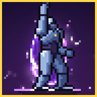

# PIXEL WAR

**A pixel-art action campaign for Android**

Five cursed worlds &middot; fifteen stages &middot; five bosses &middot; eight weapons &middot; hand-animated pixel effects

[**Website**](https://syedayeshulhassanbukhari.github.io/Pixel-War/) &nbsp;&middot;&nbsp;
[**Download the APK**](downloads/PixelWar.apk) &nbsp;&middot;&nbsp;
[**Developer portfolio**](https://syedayeshulhassanbukhari.github.io/sudo-ayesh/#hero)

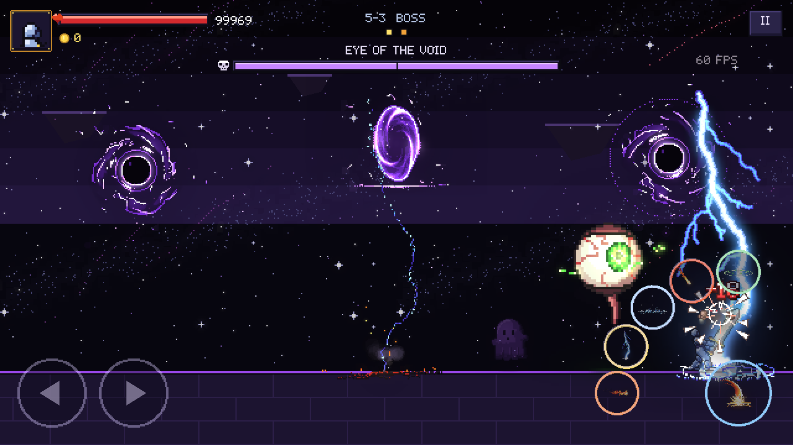

---

## About

Cut through five worlds as an armoured knight. Pick from eight weapons, call down lightning and meteors, freeze whole waves, and break five bosses, with every spark hand-animated, frame by frame. Pixel War is a side-view arena action game built for phones: multi-touch controls, every screen shape from 4:3 tablets to 21:9 phones, and short stages you can clear in a couple of minutes.

## Features

| | |
|---|---|
|  **Hand-animated effects** | Every flame, bolt, splash and shatter is a frame-by-frame pixel effect, not a particle blur. |
| 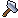 **Eight weapons** | Sword, daggers, claws, spear, whip, hammer, greatsword and scythe, each with its own swing, reach and hit timing. |
|  **Boss fights** | Five bosses with readable telegraphs: a ring on the floor fills up, then the strike lands. They get angry at half health. |
|  **Six skills** | Fireball, lightning, frost nova, meteor and heal unlock as you clear stages. Fire melts ice; frozen enemies shatter. |
|  **Stars and upgrades** | Three stars per stage: clear it, stay healthy, beat par time. Spend coins on skills, health and new weapons. |
|  **Made for phones** | Multi-touch controls, notch-safe HUD, adjustable button size, with keyboard and gamepad support too. |

## Five worlds

<table>
<tr>
<td width="50%">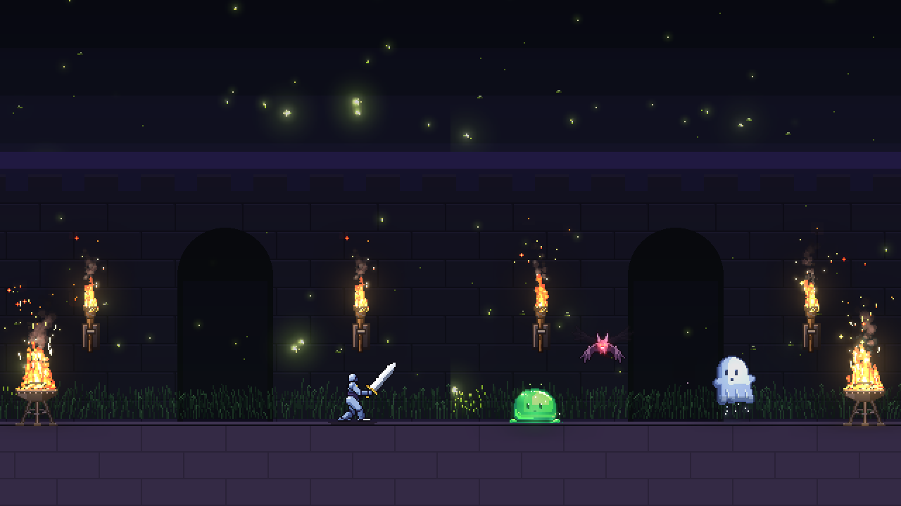 <b>1 &middot; Ashen Crypt</b> Torch-lit halls of slimes, bats and ghosts. <i>Boss: King Slime</i></td>
<td width="50%">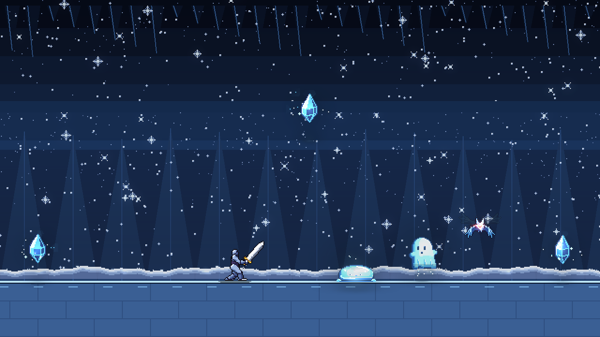 <b>2 &middot; Frostbite Cavern</b> Falling icicles, frost slimes and ghosts. <i>Boss: Frost Wraith</i></td>
</tr>
<tr>
<td>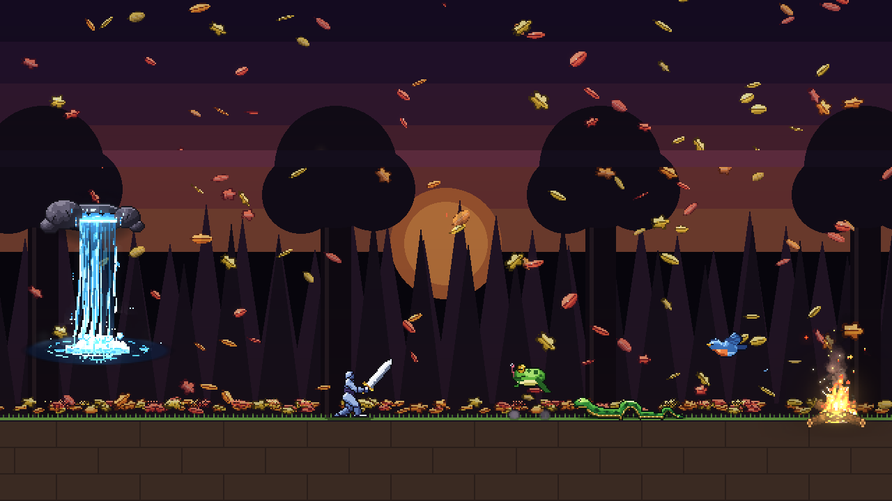 <b>3 &middot; Thornwood</b> Poison clouds, frogs, snakes and birds. <i>Boss: Elder Toad</i></td>
<td>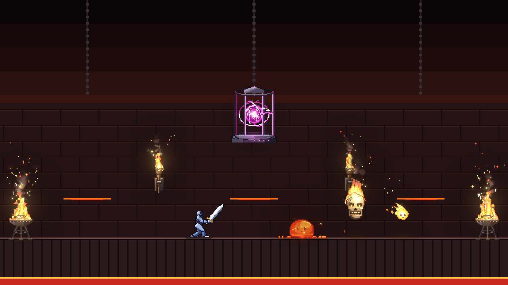 <b>4 &middot; Ember Forge</b> Flame vents, magma slimes and diving wisps. <i>Boss: Inferno Skull</i></td>
</tr>
<tr>
<td colspan="2" align="center">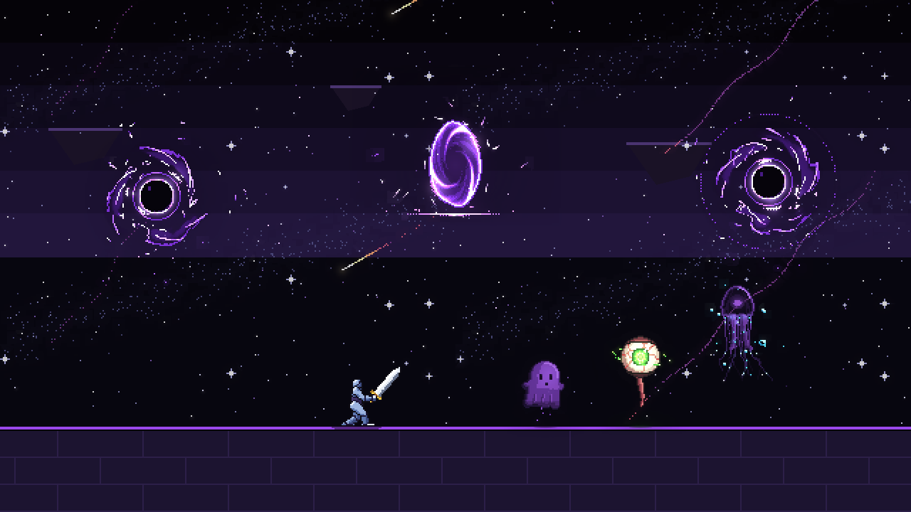 <b>5 &middot; Void Rift</b> Shadow hands and lightning storms. <i>Boss: Eye of the Void</i></td>
</tr>
</table>

## The arsenal

| | Weapon | Price | Style |
|---|---|---|---|
|  | **Sword** | starter | Fast and reliable |
|  | **Daggers** | 90 | Seven quick stabs, high crit chance |
|  | **Claws** | 120 | Three rakes, short but relentless |
|  | **Spear** | 150 | Long reach, sweeps behind you too |
|  | **Whip** | 180 | The longest reach, stuns |
|  | **Hammer** | 260 | Slow, crushes and stuns everything near |
|  | **Greatsword** | 320 | A huge, wide, heavy cleave |
| 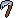 | **Scythe** | 400 | Reaps both sides, heals you a little |

## Screenshots

<table>
<tr>
<td>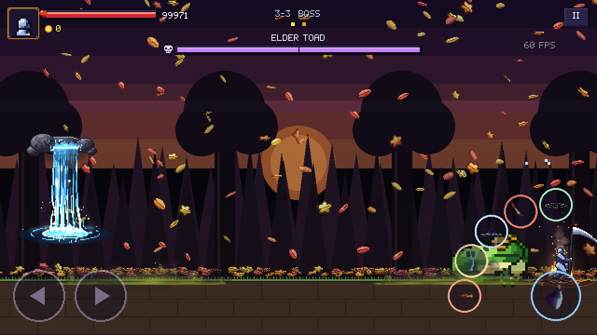</td>
<td>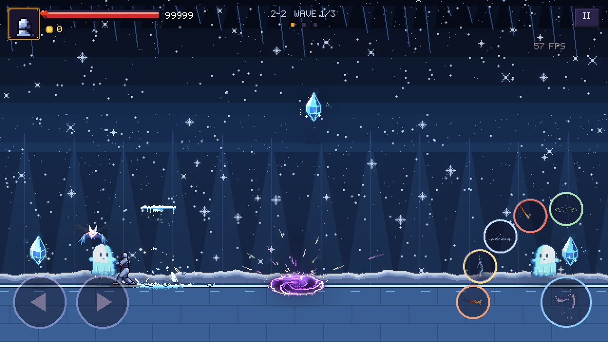</td>
</tr>
<tr>
<td>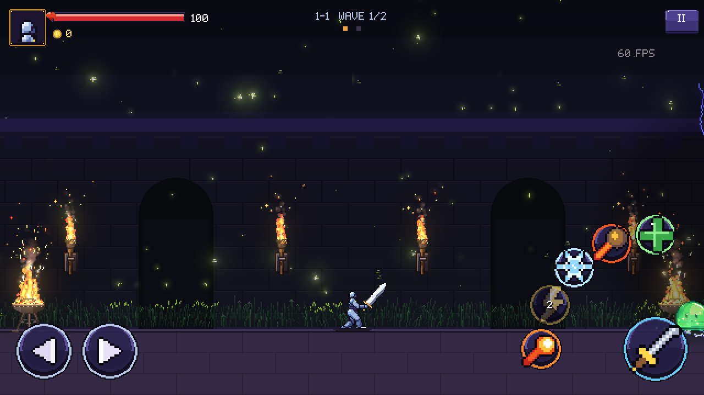</td>
<td>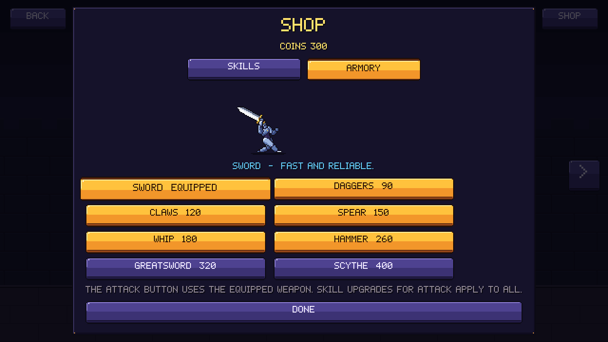</td>
</tr>
</table>

## Install

1. Download [**PixelWar.apk**](downloads/PixelWar.apk) on your Android phone (Android 7.0 or newer, 64-bit).
2. Open it. If Android asks, allow installs from your browser or file manager.
3. Play. Progress saves automatically.

**Controls:** on-screen arrows and skill buttons on phones. On a keyboard, `A`/`D` to move, `J K L U I O` for skills and `Esc` to pause. Gamepads work too.

## This repository

This is the game's website, served by GitHub Pages: plain HTML, CSS and JavaScript, with no build step. It draws with the game's own art:

- headings in the game's 5&times;7 pixel font, from its bitmap sheet
- the game's 9-slice buttons and studded panels, via CSS `border-image`
- live sprite sheets of the knight, critters and spell effects, played on `<canvas>`

To run it locally: `python -m http.server` in this folder, then open http://localhost:8000.

## Credits

**Designed and developed by Ayesh Ul Hassan** ([sudo-ayesh](https://syedayeshulhassanbukhari.github.io/sudo-ayesh/#hero)), game developer working in Unreal Engine 5, Roblox and Unity.

[Portfolio](https://syedayeshulhassanbukhari.github.io/sudo-ayesh/#hero) &middot; [itch.io](https://sudo-ayesh.itch.io/) &middot; [GitHub](https://github.com/syedayeshulhassanbukhari) &middot; [LinkedIn](https://www.linkedin.com/in/syedaishulhassan) &middot; [Fiverr](https://www.fiverr.com/syedaish)

Pixel effects and character rig: [pixelfx](https://github.com/patch-gg/pixelfx) &middot; Engine: [Godot 4.7](https://godotengine.org) &middot; Music and sound: original chiptune
